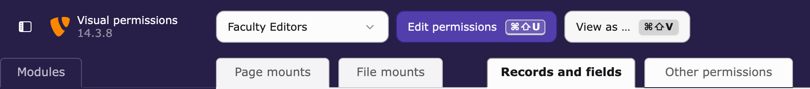
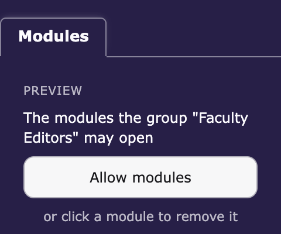
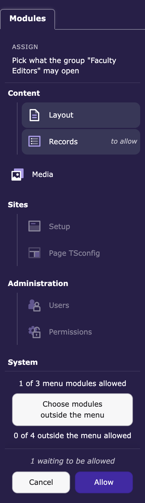
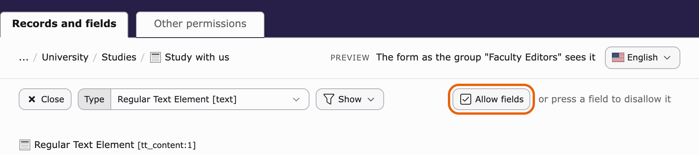
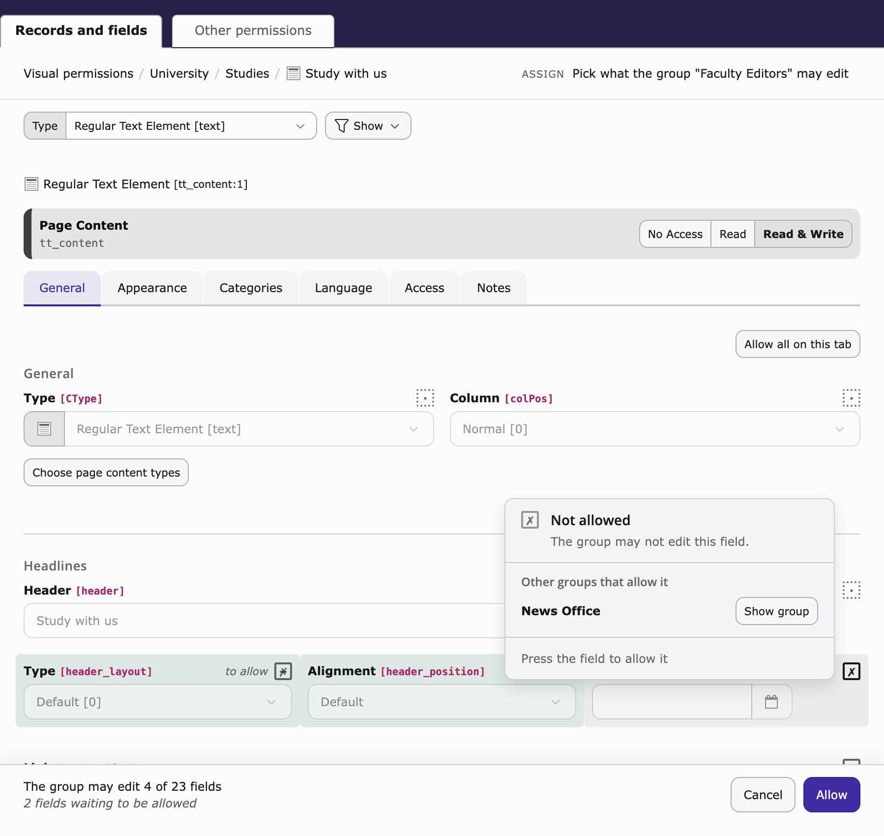
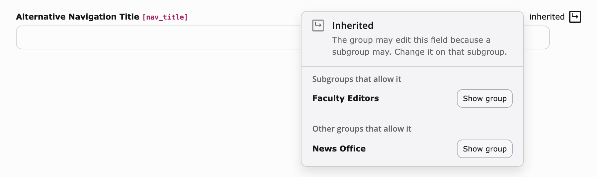
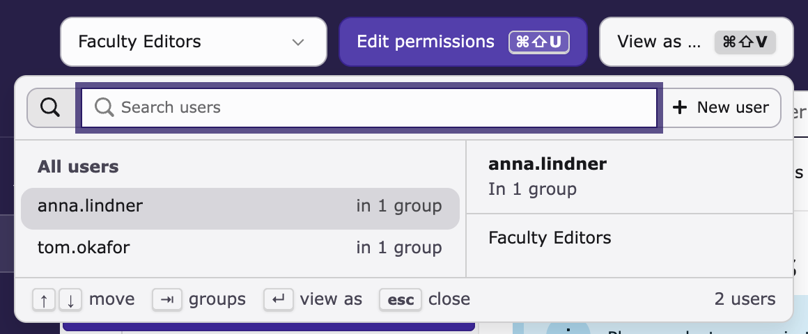

# Getting started

A walk through the backend with one group. It shows the controls, the card that every area
shares, and how to turn the record form to assign permissions.

You need an administrator account. The examples use a group called "Faculty Editors".

## 1. Pick a group and switch the view on

The toolbar holds three controls: the group picker, **Edit permissions** and **View as**.
Pick the group, then press **Edit permissions** (<kbd>Ctrl/Cmd</kbd> + <kbd>Shift</kbd> +
<kbd>U</kbd>).

A tab now stands over each area of the backend: **Modules**, **Page mounts**, **File mounts**,
**Records and fields** and **Other permissions**. Press a tab to work in that area. The other
areas fade until you pick them.

## 2. Every area is a card with two sides

The front, marked **Preview**, shows what the group has. Click an item there to remove it.

The back, marked **Assign**, shows what you can add. The button at the top of the front turns
the card: **Allow modules**, **Add page mounts**, **Add file mounts** or **Allow fields**.

| Front: what the group has | Back: what you add |
|---|---|
|  |  |

The foot of the card counts what you marked. Nothing is saved until you press **Allow** or
**Remove** there. **Cancel** drops what you marked.

A permission the group gets from a subgroup is marked as inherited. You change it on that
subgroup, not here.

## 3. Records and fields: turn the form with "Allow fields"

Open any record, a page or a content element, with **Records and fields** picked. The form now
shows what the group sees of it.

To turn the form, press **Allow fields** at the end of the button row, under the line that
says whose form this is:

On the back, every field the group does not have is offered. Press a field to mark it, then
press **Allow** in the foot. The band above the form sets how far the group reaches into the
table: **No Access**, **Read** or **Read & Write**.

On the front, press a field the group has to mark it for **Disallow**.

A form that stays empty for the group says why. With **Read** alone, for example, the group
cannot open the form at all, so the band says so.

## 4. Read a field's square

Each field carries a square at the end of its heading. Point at it, or press it, and a card
says what the square means.

- **Subgroups that allow it** names the subgroups the field comes from.
- **Other groups that allow it** names every other group that gives the field.

**Show group** switches to that group, on the same form.

## 5. Page mounts, file mounts and the rest

The page tree and the folder tree are cards too. The front shows the mounts of the group,
**Add page mounts** or **Add file mounts** turns the tree, and you mark the branches to add.
What the group may do with files is set once, with **Choose file operations** at the foot of
the File mounts card.

**Other permissions** opens the rest of the group record next to the screen you are on.

## 6. Check the result as a user

**View as** (<kbd>Ctrl/Cmd</kbd> + <kbd>Shift</kbd> + <kbd>V</kbd>) lists the users of the
group. Pick one, and the backend opens as that user. The same shortcut brings you back to the
screen where you were.

